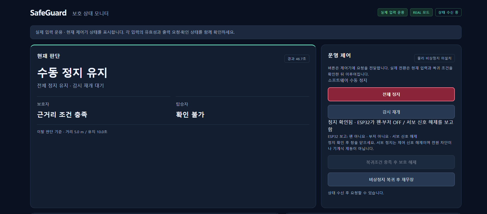
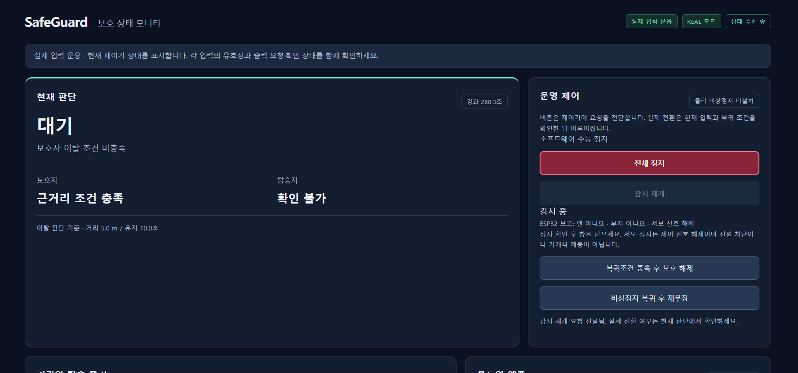
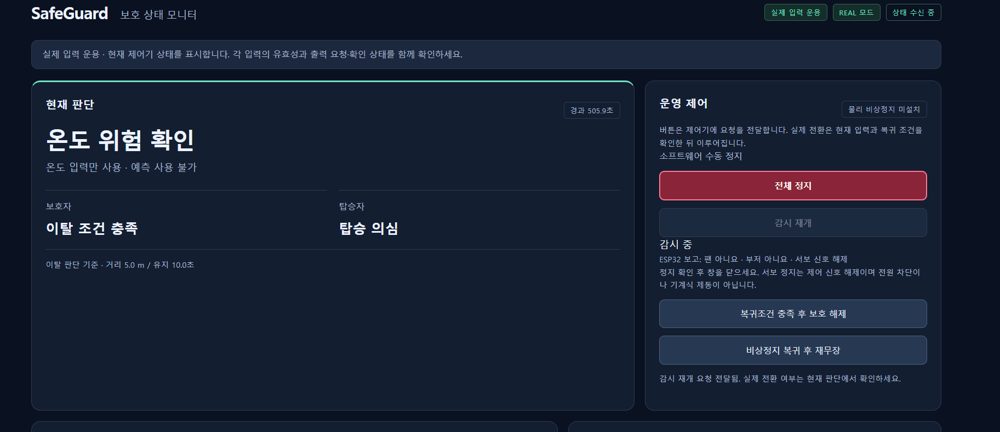
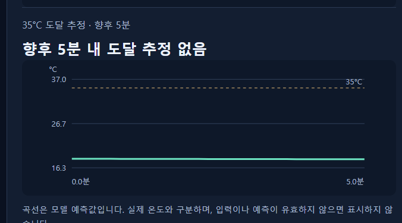
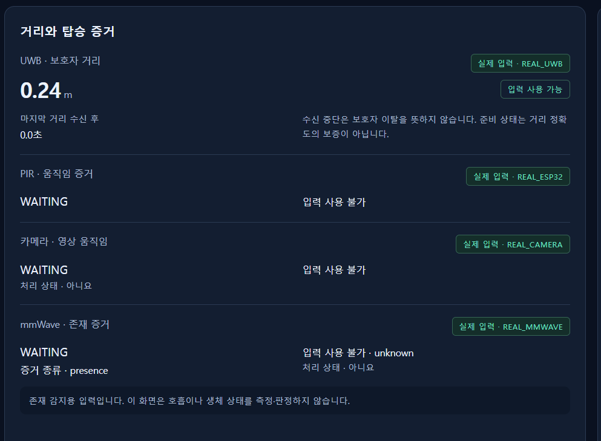
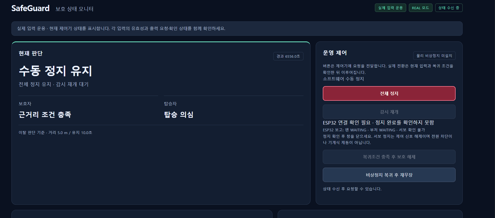
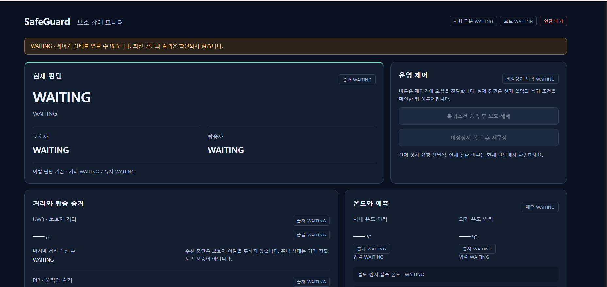

# SafeGuard 대시보드

실제 대시보드 화면을 시스템 동작 순서로 정리했습니다. 각 캡처는 해당 상태의 예시이며 화면의 수치와 표시는 원본 그대로입니다.

[작품 소개](../../README.md) · [시연 동영상](https://www.youtube.com/watch?v=aBB1S666mp4) · [사용 방법](../../prototype/docs/OPERATIONS.md)

## 1. 시작 전 — 수동 정지 확인

**'수동 정지 유지'와 '정지 확인됨'을 표시합니다.** ESP32가 팬·부저 OFF와 서보 신호 해제를 보고한 상태입니다. 실제 출력도 확인한 뒤 '감시 재개'를 요청합니다.

## 2. 감시 중 — 보호자 근거리 대기

**보호자가 가까이 있어 '대기'를 유지합니다.** 거리 5 m·유지 10초 기준과 감시 상태를 함께 보여줍니다.

## 3. 보호자 이탈·탑승 의심 — 열위험 판단

**이탈 조건과 탑승 증거에 따라 '온도 위험 확인' 단계로 진행한 화면입니다.** 이 예시에서는 '온도 입력만 사용·예측 사용 불가'를 표시해 실측 판단과 예측 준비 상태를 구분합니다.

시스템은 **UWB → PIR 또는 카메라 → mmWave → 열위험 판단**으로 이어집니다. mmWave 입력 이상 시에는 PIR·카메라의 동시 증거를 사용하는 대체 경로가 있으며, 화면의 '탑승 의심'은 그 판단 상태를 나타냅니다.

## 4. 열 예측 — 곡선과 위험 도달 시간

**예측 곡선이 35°C 기준선 아래에 있어 '향후 5분 내 도달 추정 없음'으로 표시됩니다.** 600초는 온도 이력 수집 구간이고, 향후 5분은 예측 범위입니다. 유효한 위험 도달 예상 시간과 보호 조건을 함께 판단합니다.

## 5. 선제 보호 — 보호 출력

보호자 이탈·탑승 증거·감시 조건을 만족하고 유효한 예측에서 **35°C 도달 예상 시간이 60초 이내**이면 팬·부저·서보의 보호 출력을 요청합니다. 실측 온도가 이미 35°C 이상인 직접 보호도 적용합니다.

보호 출력과 정지 동작은 [팀 시연영상](https://www.youtube.com/watch?v=aBB1S666mp4)에서 확인할 수 있습니다. 영상의 시연 온도 조건과 차량의 실제 온도 예측 정확도 평가는 구분합니다.

## 6. 종료 — 전체 정지

'전체 정지'를 요청하고 **'수동 정지 유지'와 '정지 확인됨'**, 실제 출력을 확인합니다. [1번 화면](#1-시작-전--수동-정지-확인)은 이때 확인할 표시의 예시입니다.

<strong>입력 유효성·출력 확인·연결 상태 표시</strong>

### 입력 유효성

UWB는 0.24 m로 수신되고 PIR·카메라·mmWave는 입력 대기를 표시합니다. **입력 사용 불가와 탑승자 없음은 구분합니다.** mmWave는 존재 증거를 표시하며 호흡·생체 상태를 판정하지 않습니다.

### 출력 정지 확인

정지 요청은 유지하되 ESP32 보고가 없으면 '정지 완료를 확인하지 못함'을 표시합니다. **정지 요청과 실제 제어기의 응답을 구분하는 기능입니다.**

### 상태 갱신

최신 제어기 상태를 받지 못하면 연결 대기와 WAITING을 표시합니다. 오래된 값을 정상 상태로 유지하지 않으며, 웹 화면 재접속과 제어기 실행은 별도로 관리합니다.

<strong>원본 이미지와 구현 코드</strong>

## 원본 대응표

이미지는 팀원이 대화에 첨부한 PNG 원본이며, 내용 합성이나 수치 변경을 하지 않았습니다.
파일명의 시각은 원본 식별용으로만 사용했습니다.

| 게시 파일 | 원본 첨부 파일 |
|---|---|
| `01-manual-stop.png` | `image(20261027-174302).png` |
| `02-standby.png` | `image(20261027-135721).png` |
| `03-away-thermal.png` | `image(20261027-140122).png` |
| `04-no-crossing-forecast.png` | `image(20261027-194316).png` |
| `a1-sensor-waiting.png` | `image(20261027-093915).png` |
| `a2-controller-unavailable.png` | `image(20261027-171704).png` |
| `a3-dashboard-disconnected.png` | `image(20261027-191447).png` |

설명 작성 시 참고: [판단 코드](../../prototype/SafeGuard_Main/src/core.cpp), [열 예측 코드](../../prototype/SafeGuard_Main/src/thermal_observer.hpp), 실제 화면 및 팀 시연 과정.

