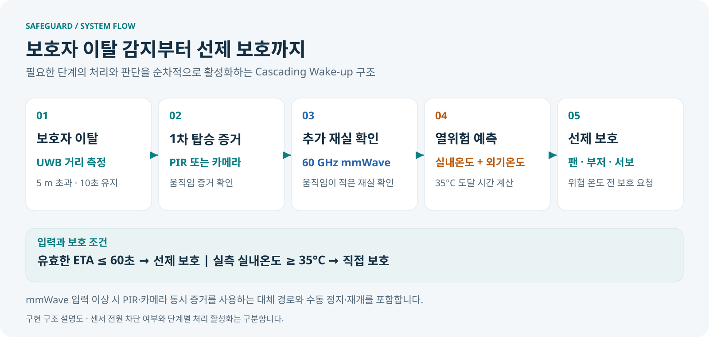

# SafeGuard 장치 구현

UWB 보호자 거리, PIR·카메라의 1차 증거, mmWave 재실 확인, 열 예측과 ESP32 보호 출력을 연결하는 차량 잔류 탑승자 보호 시스템입니다.



[검증 결과](docs/VALIDATION.md) · [열 예측 방법](docs/THERMAL_MODEL.md) · [운영·설치 안내](docs/OPERATIONS.md) · [측정 원본·그래프](measurements/README.md)

## 구현 구성

| 경로 | 역할 |
|---|---|
| `SafeGuard_Main/src/` | C++ 상태기계, 입력 유효성, 열 예측, 수동 정지 및 보호 제어 |
| `SafeGuard_Main/scripts/` | Python 센서 허브, UWB·카메라·위치/날씨 입력, 대시보드와 HTTPS 접속 |
| `SafeGuard_Main/configs/real_navigation_control.json` | 실제 입력과 보호 기준을 사용하는 운영 설정 |
| `SafeGuard_Software_Stop_20261024/firmware/SafeGuard_Software_Stop/` | ESP32 센서·구동 통신 및 소프트웨어 정지 펌웨어 |
| `hardware/mmwave/` (저장소 루트) | mmWave 수신·설정·분석 도구 |
| `SafeGuard_Main/tests/`, `test_links.py` | 상태기계·열 예측·입력·접속·제어 회귀 시험 |
| `measurements/` | 측정 원본, 분석 및 재현 자료 |
| `maintenance/` | 버전별 설치·업데이트 도구와 재현 자료 |

## 판단과 보호 기준

- 보호자 이탈: UWB 거리 5 m 초과가 10초 유지.
- 1차 탐지: PIR 또는 카메라 증거. mmWave 추가 확인으로 온도 판단 단계 진입.
- 입력 이상 대체 경로: mmWave를 사용할 수 없을 때 PIR·카메라의 동시 증거를 활용.
- 열 예측: 실내온도·위치 기반 외기온의 600초 이력으로 향후 300초 곡선과 35°C 도달 예상 계산.
- 선제 보호: 기존 감지 조건과 유효한 예측을 만족하며 ETA≤60초일 때 팬·부저·서보 요청.
- 직접 보호: 실측 실내온도 35°C 이상. 전체 정지·보호 유지와 입력 유효성 정책을 함께 적용.
- 부팅·제어기 재시작 후 정지 유지. 대시보드에서 명시적으로 감시 재개.

## 장치 구성

| 역할 | 장치 |
|---|---|
| 호스트 | Raspberry Pi 5 |
| 센서·구동 노드 | ESP32, CP2102 USB UART |
| 실내 온습도 | SHT31 |
| 보호자 거리 | DWM1001-DEV |
| 1차 움직임 증거 | PIR, Pi Camera Module 3 |
| 추가 재실 확인 | IWR6843ISK-ODS 60 GHz mmWave |
| 보호 출력 | 팬, 부저, 서보 |

핀·전압·구동 범위와 실제 USB 경로는 [하드웨어 안내](../hardware/README.md) 및 대상 장치 설정을 대조합니다. `firmware/esp32_reference`와 과거 시험 스케치는 현재 소프트웨어 정지 펌웨어와 구분합니다.

## 빌드와 재현

Linux/Pi에서 CMake, C++17 컴파일러, nlohmann-json 헤더를 사용합니다. 실제 센서 런타임에는 pyserial, NumPy, OpenCV, Picamera2 및 카메라 드라이버가 필요합니다.

```bash
cd prototype
cmake -S SafeGuard_Main -B SafeGuard_Main/build -DCMAKE_BUILD_TYPE=Release
cmake --build SafeGuard_Main/build --parallel 2
ctest --test-dir SafeGuard_Main/build --output-on-failure
python3 test_links.py
```

추가 JSON 헤더 경로는 `-DJSON_INCLUDE_DIR=/path/to/include`로 지정합니다. GitHub 소스 복제와 Pi 서비스 설치, ESP32 펌웨어 업로드는 별도 작업입니다. [운영 안내](docs/OPERATIONS.md)의 최초 설치 절차와 정지 확인을 따른 뒤 감시를 시작합니다.

[공동 작업 절차](CONTRIBUTING.md) · [소스 출처 기록](docs/SOURCE_ORIGINS.json)
